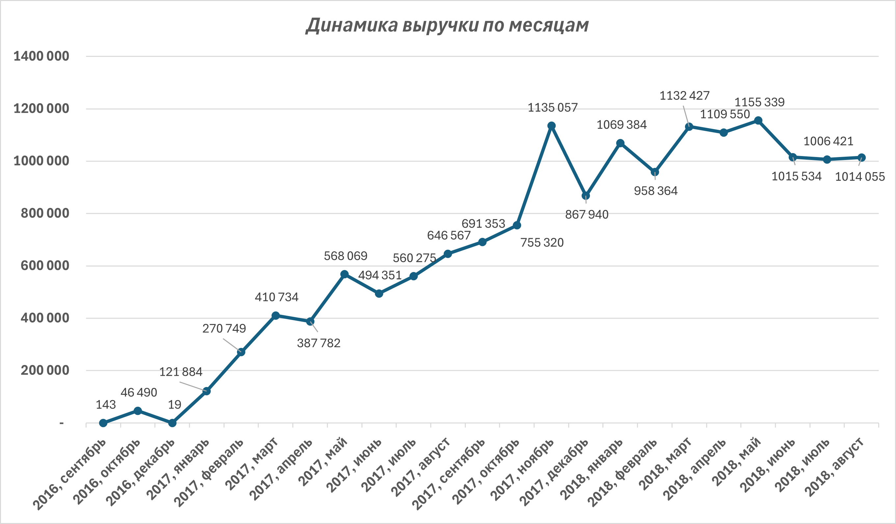
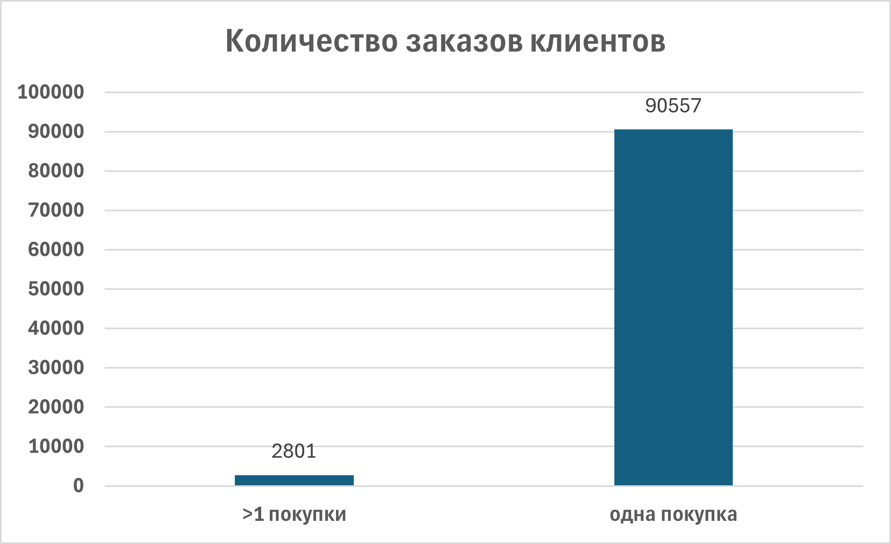

## 1. Обзор проекта.

### E-commerce датасет бразильского интернет-магазина.

### Dataset
Source:
https://www.kaggle.com/datasets/olistbr/brazilian-ecommerce

### Цель проекта
Провести аналитическое исследование продаж интернет-магазина, изучить динамику выручки, поведение клиентов и выявить ключевые особенности данных.

### Основные задачи
- Выполнить проверку качества данных и выявить аномалии
- Рассчитать общую выручку по доставленным заказам
- Проанализировать динамику выручки по месяцам
- Изучить поведение клиентов и долю повторных покупок
- Сформулировать бизнес-выводы на основе полученных результатов

## 2. Обзор БД.

### customers — клиенты
- customer_id — идентификатор записи клиента (может повторяться)
- customer_unique_id — уникальный пользователь (один человек)
- customer_zip_code_prefix — почтовый индекс
- customer_city — город клиента
- customer_state — штат

### orders — заказы
- order_id — уникальный идентификатор заказа
- customer_id — ссылка на клиента
- order_status — текущий статус заказа
- order_purchase_timestamp — дата оформления заказа
- order_approved_at — дата подтверждения оплаты
- order_delivered_carrier_date — передача заказа в доставку
- order_delivered_customer_date — фактическая доставка клиенту
- order_estimated_delivery_date — ожидаемая дата доставки

### order_items — состав заказа
- order_id — ссылка на заказ
- order_item_id — номер позиции внутри заказа
- product_id — ссылка на товар
- seller_id — продавец товара
- shipping_limit_date — крайний срок отправки
- price — стоимость товара
- freight_value — стоимость доставки

### products — товары
- product_id — уникальный идентификатор товара
- product_category_name — категория товара
- product_name_length — длина названия
- product_description_length — длина описания
- product_photos_qty — количество фото товара
- product_weight_g — вес товара (граммы)
- product_length_cm — длина (см)
- product_height_cm — высота (см)
- product_width_cm — ширина (см)

## 3. Анализ выручки.
### 3.1 Расчёт общей выручки.
Сначала узнаем какие есть статусы заказов, всего их - восемь.
```postgresql
select distinct order_status from orders;
```
- shipped — отправлен
- unavailable — недоступен / не может быть выполнен
- invoiced — выставлен счёт
- created — создан
- approved — подтверждён (обычно подтверждена оплата)
- processing — в обработке
- delivered — доставлен
- canceled — отменён

Для расчёта выручки были использованы только заказы со статусом delivered, так как остальные статусы не гарантируют успешное завершение покупки и получение оплаты.

Так же проверим есть ли аномальные данные в таблице orders по доставленным заказам, нарушающие бизнес-логику обработки заказов.

### Запрос

```postgresql
select 
    order_id,
    case 
        when order_approved_at is null then 'нет подтверждения оплаты'
        when order_delivered_carrier_date is null then 'нет передачи в доставку'
        when order_delivered_customer_date is null then 'нет даты доставки'
    end as anomaly_type
from orders
where order_status = 'delivered'
and (
    order_approved_at is null
    or order_delivered_carrier_date is null
    or order_delivered_customer_date is null
);
```
### Результат

В заказах со статусом delivered выявлены следующие несоответствия:
- 14 — отсутствует подтверждение оплаты
- 2 — отсутствует дата передачи в доставку
- 8 — отсутствует дата доставки

### Вывод
Обнаруженные аномалии противоречат логике бизнес-процесса (доставленный заказ должен иметь все этапы обработки).

```postgresql
with anomalies as (
    select order_id
    from orders
    where order_status = 'delivered'
      and (order_approved_at is null
        or order_delivered_carrier_date is null
        or order_delivered_customer_date is null)
)
select round(100.0 * (select count(*) from anomalies) / count(*), 2) as anomaly_percent
from orders
where order_status = 'delivered';
```
Результат этого запроса показал, что доля заказов с аномальными значениями всего 0.02%.

Аномалии носят единичный характер и не оказывают значимого влияния на результаты анализа, поэтому дополнительная фильтрация данных в рамках данного проекта не требуется.

### Запрос

```postgresql
select floor(sum(oi.price + oi.freight_value)) as total_sum
from order_items as oi
inner join orders AS ord ON oi.order_id = ord.order_id
where ord.order_status = 'delivered'
```
### Результат

### Общая выручка: 15 419 773

## 3.2 Динамика выручки по месяцам.

### Запрос

```postgresql
select 
to_char(date_trunc('month', ord.order_purchase_timestamp), 'YYYY-MM') as month_num,
floor(sum(oi.price + oi.freight_value)) as total_month
from orders as ord
inner join order_items as oi on ord.order_id = oi.order_id
where ord.order_status = 'delivered'  
group by month_num
order by month_num;
```

### График



Мы наблюдаем положительную динамику, есть скачки по выручке, вероятно это связанно с сезонностью или какими-то акциями.


## 4. Анализ клиентов.
### 4.1 Общее количество уникальных клиентов.
### Запрос.

```postgresql
select count(distinct cus.customer_unique_id)
from customers as cus
inner join orders as ord on  cus.customer_id = ord.customer_id
where ord.order_status = 'delivered'
```
### Результат: 93358

### 4.2 Сколько заказов делают клиенты.
### Запрос.

```postgresql
with T as(select 
cus.customer_unique_id as count_people,
count(cus.customer_id) as count_pay
from customers as cus
join orders as ord on cus.customer_id = ord.customer_id
where ord.order_status = 'delivered'
group by cus.customer_unique_id)

select 
	case
		when count_pay = 1 then 'одна покупка'
		else '>1 покупки'
	end as segment,
	count(count_people)
from T
group by segment;
```
### Результат.


### Вывод
Значительная часть клиентов совершает только одну покупку и не возвращается за повторными заказами.
Это может указывать как на особенности ассортимента магазина (например, товары длительного пользования), так и на низкий уровень повторных продаж.

Если основную долю составляют товары с редкой периодичностью покупки (техника, электроника, мебель и т.д.), подобное распределение является ожидаемым и не обязательно свидетельствует о проблемах бизнеса.

Однако в случае товаров повседневного спроса высокая доля разовых клиентов может говорить о слабом удержании аудитории и высокой зависимости бизнеса от постоянного привлечения новых пользователей через маркетинг.

## 5. Итоги

### В ходе анализа e-commerce датасета были исследованы ключевые показатели интернет-магазина: выручка, динамика продаж, качество данных и поведение клиентов.

### Основные результаты анализа:
- Общая выручка по доставленным заказам составила 15.4 млн.
-  Выручка демонстрирует положительную динамику на протяжении всего периода наблюдений.
### В данных были обнаружены единичные аномалии, противоречащие бизнес-логике обработки заказов:
- отсутствующее подтверждение оплаты,
- отсутствие передачи в доставку,
- отсутствие даты доставки при статусе delivered.


Доля аномальных записей составила всего 0.02%, поэтому они не оказывают значимого влияния на результаты анализа.

Анализ выручки по месяцам показал неравномерное распределение продаж в течение года.
Наиболее высокие показатели выручки наблюдаются в период с марта по август, а пиковые значения приходятся на май и август.
Полученные результаты могут указывать на наличие сезонности спроса, однако для подтверждения данной гипотезы требуется более длительный период наблюдений.
Большинство клиентов совершают только одну покупку и не возвращаются за повторными заказами.
Высокая доля разовых покупателей может быть связана как со спецификой ассортимента (товары длительного пользования), так и с низким уровнем повторных продаж.
Общий вывод

Несмотря на наличие незначительных аномалий в данных, датасет подходит для проведения базового аналитического исследования.
Проведённый анализ позволил выявить рост выручки, возможные признаки сезонности и особенности клиентского поведения.

### В рамках проекта были использованы:

- PostgreSQL
- SQL (JOIN, GROUP BY, CTE, агрегатные функции)
- Excel (визуализация данных и построение графиков)

Проект демонстрирует базовые навыки аналитики данных:

- подготовку и проверку данных,
- расчёт бизнес-метрик,
- визуализацию результатов,
- формулирование аналитических выводов.

